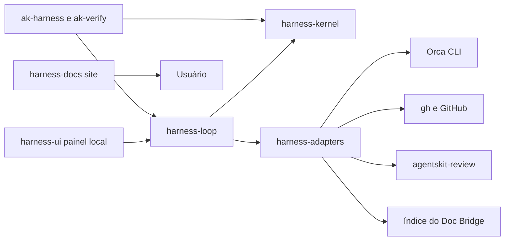

# 00 Hub - harness

> [!tldr] Em linguagem comum
> O Harness organiza a esteira de desenvolvimento, da ideia à entrega: congela o que "pronto" significa, deixa um agente trabalhar, confere as provas e só junta o código quando as regras e as pessoas certas concordaram.

← [[Camada - Ferramentas]]

## Para que existe e quem usa

Dois produtos no mesmo pacote npm `@agentskit/harness` (versão 0.22.3 em `harness/package.json:3`, licença MIT, Node ≥ 22):

1. **O loop "keep-pushing"** — `ak-harness loop …`: um objetivo vago vira PRD, design e issues; cada issue vira contrato congelado, worker em worktree próprio, PR revisado e provado contra uma definição de pronto, merge e, atrás de um portão humano, release (`harness/README.md:9-11`).
2. **O protocolo de verificação** — `ak-harness`/`ak-verify`: contrato congelado, checagens executáveis presas ao `HEAD` do git e decisão humana explícita (`harness/README.md:185-205`). O loop é construído em cima dele (`harness/AGENTS.md:5-9`: "o Playbook documenta práticas; o Harness as impõe").

| Público | Uso |
|---|---|
| Quem opera uma fila de issues com agentes | `loop init/doctor/install`, painel local (`ak-harness ui`) |
| Quem constrói sobre o protocolo | Importa `@agentskit/harness` (só `src/index.ts` é API suportada) |
| Agentes de código | Skill `ak-harness-loop` para inspecionar/operar o loop (`harness/skills/ak-harness-loop/SKILL.md`), página `/for-agents/` do site |
| Equipe AgentsKit | Integração com [[00 Hub - code-review]] (revisão), [[00 Hub - doc-bridge]] (contexto e gates de doc) e [[00 Hub - agentskit]] (`@agentskit/core`, `cross-platform`, `net`; manifesto do ecossistema) |

| Característica | O que está declarado |
|---|---|
| Visibilidade | Público; o único workspace extra, o site de docs, é pacote privado (`harness/apps/docs/package.json:4`) |
| Stack | TypeScript ESM (`tsup`), Node ≥ 22, `commander`, `zod`, `yaml`, `ink`/`react` (instalador em terminal), Vite + React + Tailwind (painel), Next.js 16 + Fumadocs (site, workspace separado) (`harness/package.json:109-141`, `harness/apps/docs/package.json:12-30`) |
| Binários | `ak-harness` e `ak-verify`, o **mesmo** `dist/cli.js` (`harness/package.json:6-9`) |
| Dependências do ecossistema | `@agentskit/core ^1.13.0`, `@agentskit/cross-platform ^0.1.0`, `@agentskit/net ^0.2.0`; `@agentskit/doc-bridge` só em dev (`harness/package.json:110-112`, `:120`) |
| Ferramentas externas exigidas pelo loop | CLI `orca`, `gh`, `git`, `agentskit-review` e os CLIs de agente (`claude`, `codex`, `grok`, `opencode`) |
| Integração com [[00 Hub - fleet]] | **Não demonstrada**: nenhuma ocorrência de "fleet" em `src/`, `docs/`, `README.md` ou `skills/` |

## Partes principais

| Nota | Papel |
|---|---|
| [[harness-kernel]] | Protocolo de verificação e biblioteca determinística: estados, eventos encadeados por hash, política, runtimes, pacote de evidência, benchmarks, portões de entrega |
| [[harness-adapters]] | Tomadas para Orca, GitHub, Linear (via Orca), revisão de código, Doc Bridge, RAG e MCP — sempre por argv, nunca shell |
| [[harness-loop]] | A esteira: tick, deliver, plan, release, observe, retro, doctor, instalação das automações, configuração em quatro camadas |
| [[harness-ui]] | Painel local em loopback: fila de atenção, assistente de enfileirar, gates humanos |
| [[harness-docs]] | Site público (workspace privado `apps/docs`), referência gerada do código |

`harness-kernel`, `harness-adapters`, `harness-loop` e `harness-ui` são recortes **do mesmo pacote npm**; a divisão segue as classes de `docs/MODULE-BOUNDARIES.md:8-16` (kernel, execução, adapters, composição).

## Fluxos principais

| Fluxo | Resultado |
|---|---|
| [[Harness - Da issue ao merge]] | A issue vira contrato; um agente implementa em worktree separado; a entrega confere checks, revisão e definição de pronto e faz o merge por SHA |
| [[Harness - Planejar e liberar com decisão humana]] | Objetivo → PRD → design → issues, com dois gates humanos; versão só sai com aprovação ligada ao SHA do lote |
| [[Harness - Verificar e aprovar uma execução]] | O protocolo de uma execução: plano aprovado, checagens, selo, aprovação humana, reconciliação e pacote assinado |

## Guias (tarefas recorrentes)

| Guia | Quando |
|---|---|
| [[Validar uma mudança no Harness]] | Qualquer mudança: teste estreito agora, portão completo só no PR que fecha a issue |
| [[Mudar a API pública do Harness]] | Mexeu em `src/index.ts` |
| [[Adicionar ou mudar uma chave de configuração do loop]] | Nova opção em `loop.config.yaml` |
| [[Adicionar um adapter sem quebrar as fronteiras]] | Nova integração externa |
| [[Colocar o loop para rodar num projeto]] | Primeira instalação |
| [[Operar e diagnosticar o loop do Harness]] | Algo parece parado |
| [[Planejar e liberar uma versão com o loop]] | `loop plan` e `loop release` |
| [[Rodar e alterar a UI local do Harness]] | Painel |
| [[Atualizar e publicar a documentação do Harness]] | Site e referência gerada |
| [[Publicar uma versão do Harness no npm]] | Lançamento |
| [[Escrever commits e PRs no padrão do Harness]] | Convenções de commit e PR |

## Decisões

43 ADRs em `harness/docs/`, todos aceitos, indexados por tema em [[00 Decisões - harness]]. Os quatro que o README destaca: [[harness ADR-0027 - Loop keep-pushing sobre o Orca]], [[harness ADR-0032 - Estágios como máquinas de estado]], [[harness ADR-0035 - Definição de pronto em duas listas]] e [[harness ADR-0037 - Custo política tetos e alavancas]] (`harness/README.md:213-216`). Registro de erros da versão anterior destas notas e de divergências entre docs e código: [[Auditoria - harness]].

## Deploy e dados

- **O que roda:** a CLI roda no computador/servidor da equipe; o loop é acionado por automações do Orca (ou manualmente); a UI escuta só em `127.0.0.1:4321` (`harness/src/ui/api/server.ts:46-47`). Não há serviço SaaS obrigatório.
- **Onde os dados ficam:** `<stateDir>` (padrão `.ak-loop`, fora do git) guarda log de eventos, contratos, planos, despachos, entrega, runs, filas e decisões; `.ak-harness/` guarda o contrato de verificação e `.ak-harness/verification/` as execuções (`harness/src/loop/config.ts:122`, `harness/.ak-harness/verification.json:5`). Detalhe em [[harness-loop]] e [[harness-kernel]]; visão do ecossistema em [[Onde ficam os dados]].
- **Configuração:** quatro camadas — `~/.agentskit/harness.yaml`, `loop.config.yaml`, `loop.config.team.<key>.yaml`, `loop.config.local.yaml` (`harness/src/loop/config.ts:12-20`); o `loop.config.yaml` **não** é o `.github/ai-loop.yaml` de outro executor (`harness/README.md:144-145`).
- **Distribuição:** pacote npm via Trusted Publishing/OIDC, com proveniência, publicado a partir da `main` (`harness/.github/workflows/release-harness.yml:109-163`). Site em Cloudflare Workers com assets estáticos (`harness/wrangler.toml:1-11`); `vercel.json` coexiste como fonte dos cabeçalhos. Ver [[Infra e deploy]].

## CI e verificações declaradas

Um único workflow, `release-harness.yml` (nome de exibição "Verify harness"), roda em PR e em push na `main` (`harness/.github/workflows/release-harness.yml:1-13`):

| Job | O que confere |
|---|---|
| `verify` | `typecheck`, `test:coverage`, `build`, `check:public-api`, `pack` e a encenação `plan/start/run` do contrato do próprio repositório (`:24-47`) |
| `docs` | Config e índice do doc-bridge, gates e conformidade, `docs:generate --check`, `test:capabilities`, evidência de release, limites de JSON, `docs:build`, `test:docs-artifacts` (`:49-82`) |
| `loop-cross-platform` | Subconjunto da suíte do loop em Ubuntu, macOS e Windows, `build` e `loop validate -f loop.config.example.yaml` (`:84-104`) |
| `publish` | Depende dos três acima, só na `main` do repositório oficial; publica se a versão ainda não existe no registro (`:109-163`) |

O nome do arquivo é "load-bearing": o npm autoriza o publicador por repositório **e** nome do workflow (`:3-8`). Renovate herda a configuração de `AgentsKit-io/.github` (`harness/renovate.json:3-5`); ver [[00 Hub - .github]].

## Limites e divergências

- `ak-harness` e `ak-verify` são dois nomes do mesmo binário.
- **`connectors.runner: local` é recusado** na validação (`harness/src/loop/config.ts:1093`) embora `docs/LOOP.md`, `ADR-0034` e o guia `local-runner.mdx` o descrevam como utilizável; a versão anterior desta nota repetia essa promessa. O runner `local` existe e é testado, mas não está ligado ao despacho ([[harness ADR-0039 - Piso de auto-merge e runner local não ligado]]).
- O tracker aceita **Linear e GitHub Issues** (`harness/src/loop/config.ts:698`); o texto do ADR-0034 diz que só `linear`.
- Há dois "painéis": a UI operacional (`harness-ui`) e o site público (`harness-docs`); e uma interface de terminal (Ink) só para o instalador.
- `release/manifest.json` ainda declara dois critérios bloqueados (`ecosystem-compatibility`, `pilot-benchmark`) e um `sourceRevision` que não é o `HEAD` (`harness/release/manifest.json:7`, `:30-33`).
- Nenhuma instalação, build, teste, chamada de serviço ou alteração de infraestrutura foi executada. O que depende de ambiente real (Orca, tracker, GitHub, npm, Cloudflare) fica em [[Dúvidas abertas]].

> [!info]- Detalhe técnico
> - `harness/README.md:9-14`, `:185-205` — duas faces do produto.
> - `harness/package.json:2-9`, `:109-141` — nome, versão, binários e dependências.
> - `harness/pnpm-workspace.yaml:3-5` — workspaces `.` e `apps/*`.
> - `harness/src/loop/runner-connector.ts:19-23` — "uma interface com uma só implementação é um palpite".
> - `harness/.github/workflows/release-harness.yml:109-120` — publicação serializada, nunca cancelada.
> - `harness/compatibility/manifest.json:7-13` — componentes AgentsKit fixados por revisão (`core`, `memory`, `eval`, `doc-bridge`, `code-review`) usados pela avaliação de compatibilidade (a versão `harnessVersion` do manifesto é 0.4.0; não foi atualizada).
> - doc-bridge: `harness/doc-bridge.config.json:41-58` declara as áreas `harness-site` e `ecosystem-manifest`; o índice não descreve `src/`.
