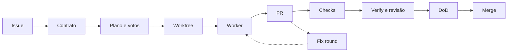

# Harness - Da issue ao merge

> [!tldr] Em linguagem comum
> Uma issue vira um contrato congelado; um agente trabalha num espaço separado e deixa três arquivos de prova; a entrega confere checagens, revisão e definição de pronto e só então faz o merge — parando para uma pessoa nos pontos que a política define.

← [[00 Hub - harness]]

## Entrada e resultado

**Entrada:** uma issue na fila (Linear, via Orca, ou GitHub Issues, via `gh`) dentro de `linear.states`/labels de fila, ou uma run confirmada pelo painel ([[harness-ui]]). **Resultado:** PR mergeado por SHA revisado, issue em `Done`, worktree removido (se `delivery.cleanupWorktree`) e um registro de run em `<stateDir>/runs/`. Os dois estágios — `tick` e `deliver` — são agendados como automações do Orca que chamam `loop stage tick|deliver`; o precheck só dispara um worker destacado e sai com 1 (`harness/src/cli.ts:174-223`).

| Etapa | O que acontece | Evidência |
|---|---|---|
| 1. Intake | Lê a fila do dono configurado (ou as runs enfileiradas pela UI), cruza com leases, worktrees e branches ocupados e descarta issues pausadas ou com pergunta humana em aberto | `harness/src/loop/tick.ts:441-491`, `:715-749` |
| 2. Admissão | Vagas por memória/CPU (`assessSlots`) e claim atômico no ledger; "capacidade é só telemetria" no precheck | `harness/src/loop/tick.ts:494-503`, `:938-939` |
| 3. Contrato | O orquestrador lê a issue (como dado não confiável) e o repositório e devolve JSON entre `<<<LOOP_CONTRACT … LOOP_CONTRACT>>>`; só é despachável com ≥ 1 resultado executável e nenhuma ambiguidade bloqueante; senão escala com um comentário `needs-info` e, quando há decisão estruturada, abre um pedido HITL | `harness/src/loop/contract.ts:23-24`, `:155-162`; `harness/src/loop/tick.ts:858-871` |
| 4. Plano e votos (opcional) | Com `worker.plan.enabled`, planejador e votantes rodam dentro do harness antes de existir worktree; 2 de 3 aprovam, senão escala com as objeções | `harness/src/loop/tick.ts:875-929`; `harness/src/loop/plan-vote.ts:238` |
| 5. Despacho | `git fetch`, `orca worktree create` (3 tentativas para quedas de IPC), worker guard, comando de preparo, spec renderizada, brief como arquivo + uma linha no terminal, `worker.dispatched` | `harness/src/loop/tick.ts:961-1026` |
| 6. Trabalho do agente | O worker escreve `.ak-loop/plan.md`, `verify.json` e `dod.json`; o harness não vê a sessão, só o worktree | `harness/src/loop/artifacts.ts:9-14` |
| 7. Entrega, sem PR | Espera; check-in após `workerIdleTimeoutMin`; handoff para outro provedor se o atual estiver indisponível; "BLOCKED:" do worker vira escalação; terminal sumido ou ocioso demais → reinício do zero (máx. 2) ou `stuck` | `harness/src/loop/deliver.ts:605-751`, `harness/src/loop/deliver-state.ts:114` |
| 8. Entrega, com PR | Rascunho espera; caminhos protegidos ou nome de segredo seguram; conflito pede rebase; CI vermelho vira fix round; CI pendente espera | `harness/src/loop/deliver.ts:940-973` |
| 9. Verify e revisão | `delivery.verify.argv` roda no worktree **antes** da revisão; depois `agentskit-review` no head; achados ≥ piso voltam como fix round (o mesmo head nunca é revisado de novo) | `harness/src/loop/deliver.ts:1018-1079` |
| 10. Artefatos, spec e DoD | Arquivo ausente volta como fix round nomeando-o; spec precisa estar commitada como renderizada; as duas listas de pronto precisam estar provadas e a tabela vai para o PR | `harness/src/loop/deliver.ts:1087-1141` |
| 11. Piso e aprovação | Pelo menos um portão examinou o diff; `merge.auto`; `requireHumanApproval` só mergeia quando o GitHub marca `APPROVED` | `harness/src/loop/deliver.ts:1150-1158` |
| 12. Merge e fechamento | Hook `beforeMerge`, merge REST com `sha=` da cabeça revisada, anexo do PR e comentário no tracker, estado `Done`, labels limpas, worktree removido | `harness/src/loop/deliver.ts:1175-1182`, `:753-788` |

**Contagem de fix rounds:** conflito não conta; CI e revisão contam; uma rodada de revisão em que **todos** os achados são novos naquele head ("descoberta") não conta contra `maxFixRounds`, mas há teto absoluto de 2× o limite; esgotado, a issue vira `blocked` com PR e worktree preservados (`harness/src/loop/deliver.ts:798-826`).

## Persistência, erros e recuperação

- **Estado:** `dispatch.json`, `delivery.json`, `contract.json`, `plan.json`, `events.ndjson` e o diretório de run (lista completa em [[harness-loop]]).
- **Falhas antes do despacho:** `resilience.maxConsecutiveFailures` (3) pausa a issue com label e comentário; `resilience.stagePauseAfterRuns` pausa o estágio; `loop resume` limpa (`harness/src/loop/tick.ts:658-684`, `harness/src/cli.ts:104-112`).
- **Falhas na entrega:** um erro transitório vira `waiting`; 3 seguidos viram `failed` e liberam o lease (`harness/src/loop/deliver.ts:123`, `:1451-1459`).
- **Rate limit do tracker:** o tick devolve `blocked` e espera; a entrega pula só as escritas no tracker (`harness/src/loop/tick.ts:549-555`, `harness/src/loop/deliver.ts:1336-1337`).
- **Custo e tempo:** `delivery.maxDispatchMinutes`, `resilience.maxUsageDeltaPercent` e `budget.perIssueTokens` escalam como worker preso, com worktree preservado (`harness/src/loop/deliver.ts:1353-1383`).
- **Humano no circuito:** contrato ambíguo ou pedido do plano/revisão/worker vira pergunta estruturada na Caixa de entrada; PR que toca caminhos protegidos espera `loop approve <issue> --head <sha> --by <pessoa>` (`harness/src/cli.ts:353`).

| Limite da evidência | Resultado |
|---|---|
| Escopo | Sequência reconstruída do código e das docs de [[00 Hub - harness]]; não executada, não confirmada em produção |
| Divergência de docs | `docs/LOOP.md:118-120` diz que `deliver` roda inline no precheck; o código o dispara como worker destacado (ver [[Auditoria - harness]]) |

Veja também [[Harness - Planejar e liberar com decisão humana]] (o que acontece antes e depois) e [[Operar e diagnosticar o loop do Harness]].

> [!info]- Detalhe técnico
> - `harness/src/loop/tick.ts:523` (`runTick`), `harness/src/loop/deliver.ts:1300` (`runDeliver`), `harness/src/loop/deliver.ts:931` (`handlePullRequest`), `harness/src/loop/deliver.ts:605` (`handleNoPullRequest`), `harness/src/loop/deliver.ts:817` (`fixRound`).
> - A ordem dos portões de um PR e a lista de resultados (`DeliverOutcome`) estão em [[harness-loop]]; os ADRs: [[harness ADR-0032 - Estágios como máquinas de estado]], [[harness ADR-0035 - Definição de pronto em duas listas]], [[harness ADR-0039 - Piso de auto-merge e runner local não ligado]].
> - Runner: o despacho chama o Orca diretamente (`orcaWorktreeCreate`, `harness/src/loop/tick.ts:963`); o runner `local` é recusado na configuração (`harness/src/loop/config.ts:1093`) — versão anterior desta nota dizia que o tick usava "runner Orca ou local".
