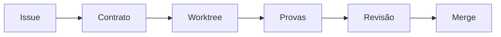

# Harness - Da issue ao merge

> [!tldr] Em linguagem comum
> A issue vira um contrato verificável; um agente implementa em espaço separado e a entrega passa por provas e revisão.

← [[00 Hub - harness]]

## O que acontece

1. [[harness-loop]] lê configuração e tracker, seleciona issue e congela contrato/plano com limites e perfil.
2. Tick usa runner Orca ou local para criar worktree, abrir agente e registrar dispatch.
3. Worker deixa .ak-loop/plan.md, verify.json e dod.json com provas por resultado.
4. Deliver verifica artefatos, executa comando local, chama [[code-review-engine]] e pede correções quando os gates falham.
5. Merge depende da definição de pronto, checks e política de aprovação humana do perfil. Tracker/estado de entrega são reconciliados.
6. [[harness-ui]] mostra projeções e decisões; observação de workspace não substitui a revisão/checks que vêm do SCM.

| Limite da evidência | Resultado |
|---|---|
| Escopo | Sequência reconstruída de código e docs de [[00 Hub - harness]]; não executada nem confirmada em produção |

> [!info]- Detalhe técnico
> - `harness/src/loop/tick.ts:1`.
> - `harness/src/loop/deliver.ts:1300`.
> - `harness/src/loop/artifacts.ts:1`.
> - `harness/src/loop/runner-connector.ts:15`.
