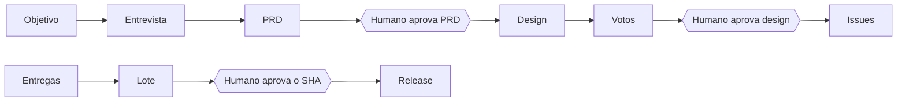

# Harness - Planejar e liberar com decisão humana

> [!tldr] Em linguagem comum
> Um objetivo vago vira PRD, design e issues com duas aprovações humanas no caminho; depois das entregas, uma versão só sai para produção se uma pessoa aprovou exatamente aquele lote de código.

← [[00 Hub - harness]]

## Entrada e resultado

**Entrada:** `ak-harness loop plan start "<objetivo>"` (ou, sem pessoa digitando, alertas de `loop stage intake` e checagens de `loop stage maintain`). **Resultado:** issues na fila (estado de entrada do tracker) e, depois de entregues, um lote promovido para `release.branch` com deploy, smoke e rollback declarados pelo projeto.

| Etapa | O que acontece | Evidência |
|---|---|---|
| 1. Entrevista | Uma pergunta por rodada, com alternativas e recomendação; a entrevista só termina quando a **máquina** vê `objective`, `users`, `inScope` e `successCriteria` preenchidos e nenhuma pergunta aberta | `harness/src/loop/plan-stage.ts:45`, `:281-289` |
| 2. Portão humano 1 | `loop plan approve <id>` — só plano em fase `review` e sem lacunas | `harness/src/loop/plan-stage.ts:298-303` |
| 3. Arquitetura e votos | O arquiteto desenha o PRD inteiro; `worker.plan.votes` votantes (padrão 3, aprovação 2) votam; objeção obrigatória para rejeitar; até `maxCycles` ciclos | `harness/src/loop/plan-stage.ts:311-342` |
| 4. Portão humano 2 | `loop plan approve-design <id>`; consenso com objeções abertas só passa com `--accept-objections`, e elas viajam para a decomposição | `harness/src/loop/plan-stage.ts:355-361` |
| 5. Decomposição | Issues com label de camada, prioridade, critérios verificáveis e `designRef`; `--create` grava no estado de **entrada** da fila — mover para o estado despachável continua gesto humano | `harness/src/loop/plan-stage.ts:364-369`, `:386-431` |
| 6. Lote | As issues mergeadas na base viram um lote: commits sem merge em `<release.branch>..<base>` agrupados pela issue citada no assunto | `harness/src/loop/release.ts:49-69` |
| 7. Portão humano 3 | `loop release approve` grava o SHA da cabeça; qualquer commit novo muda o lote e exige nova aprovação; a aprovação é gasta numa promoção bem-sucedida | `harness/src/loop/release.ts:77-84`, `:141-142`, `:151-152` |
| 8. Promoção e deploy | Notas de release (se `release.notesFile`) são commitadas **antes**; `git push origin <head>:refs/heads/<branch>`; depois `release.deploy` e `release.smoke` | `harness/src/loop/release.ts:155-183` |
| 9. Smoke falhou | Roda `release.rollback`, registra e escala; sem rollback declarado, "um humano precisa decidir" | `harness/src/loop/release.ts:185-194` |

O princípio é a **separação de papéis do kernel**: evidência técnica, aprovação humana e autorização são coisas diferentes; `assertHuman` não aceita outro ator (`harness/src/kernel/state-machine.ts:12`). A tabela de todos os pontos de parada está em `harness/apps/docs/content/docs/concepts/human-gates.mdx:9-19`.

## Persistência, erros e recuperação

- Estado do plano em `<stateDir>/plans/<id>/state.json` (`harness/src/loop/plan-stage.ts:131`); estado de release em `<stateDir>/release.json` com histórico (`harness/src/loop/release.ts:35`, `:151-152`); PRD e design podem ser escritos como documentos no checkout (`harness/src/loop/documents.ts`).
- Modelo ausente ou saída fora do formato: o estágio falha com a mensagem do bloco esperado (ex.: `<<<LOOP_DESIGN … LOOP_DESIGN>>>`, `harness/src/loop/plan-stage.ts:23-24`).
- Aviso de lote esperando é emitido **uma vez por cabeça** (`release.waiting`, `harness/src/loop/release.ts:134-139`), para um cron a cada poucos minutos não virar ruído.
- Painel: gates de PRD, design e release aparecem na fila de atenção da UI e chamam as mesmas funções (`harness/src/ui/api/attention.ts:156-161`, `harness/src/ui/api/routes-actions.ts:11-12`).

| Limite da evidência | Resultado |
|---|---|
| Escopo | Sequência reconstruída do código e das docs de [[00 Hub - harness]]; não executada nem confirmada em produção |

Veja [[Harness - Da issue ao merge]] (a entrega de cada issue) e o guia [[Planejar e liberar uma versão com o loop]].

> [!info]- Detalhe técnico
> - `harness/src/cli.ts:475`, `:492`, `:514-526` (comandos `plan approve`, `approve-design`, `release status|approve|run`); `harness/src/loop/intake.ts:83`, `:154` (intake e manutenção).
> - Votos e consenso reaproveitam `tallyVotes` (`harness/src/loop/plan-vote.ts:197`) — a mesma regra 2 de 3 do plano por issue ([[harness ADR-0032 - Estágios como máquinas de estado]]).
> - Config: `release.enabled` (padrão `false`), `release.branch` (padrão `production`, precisa diferir de `project.baseBranch`) em `harness/src/loop/config.ts:715-729` e `harness/src/loop/release.ts:128-129`.
