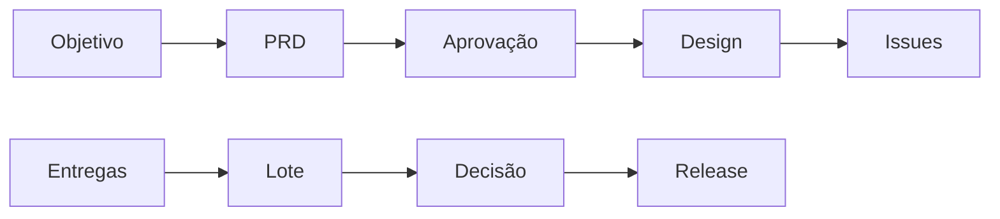

# Harness - Planejar e liberar com decisão humana

> [!tldr] Em linguagem comum
> Objetivo vira plano e issues, e uma versão só é liberada depois da aprovação vinculada ao código.

← [[00 Hub - harness]]

## O que acontece

1. O estágio plan entrevista, escreve PRD e pede aprovação do plano.
2. Arquitetura e objeções passam pelo gate de design antes da decomposição em issues.
3. Depois das entregas, release reúne lote e notas; aprovação humana fica vinculada ao head SHA.
4. Mudança do código não deve reutilizar aprovação velha. Execução e estado do release são registrados.
5. [[harness-kernel]] mantém a distinção entre evidência técnica, aprovação humana e autorização.

| Limite da evidência | Resultado |
|---|---|
| Escopo | Sequência reconstruída de código e docs de [[00 Hub - harness]]; não executada nem confirmada em produção |

> [!info]- Detalhe técnico
> - `harness/src/loop/plan-stage.ts:1`.
> - `harness/src/loop/release.ts:1`.
> - `harness/src/kernel/state-machine.ts:12`.
